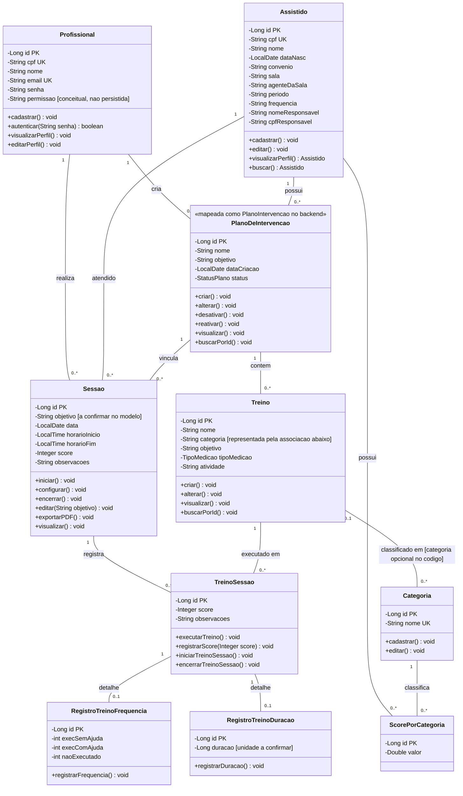

# Diagrama de Classes de Domínio — Sistema AMDE (sugestão)

> **Proposta de ajuste mínimo, não aprovada.** Preserva a organização, as classes de domínio e as operações do diagrama entregue. Corrige somente os pontos que conflitam com o código observado ou com a rastreabilidade dos documentos sugeridos. O desenho continua sendo de domínio: operações expressam responsabilidades previstas e não afirmam, por si só, que estejam implementadas.

- **Projeto:** Sistema AMDE — ClinicABA
- **Versão:** sugestão 1.0
- **Data da conferência:** 03/11/2026
- **Base de código analisada:** branch `main` no commit `a6a262963fde1c9a536ff79cf572b8e15e2b981c`; sugestão consolidada com os demais materiais acadêmicos no commit atual de `main`.
- **Escopo:** classes de domínio mantidas do documento do aluno, com campos persistidos conferidos nas entidades JPA. Itens conceituais não persistidos são explicitamente marcados.
- **Leitura:** `PK` chave primária; `UK` unicidade declarada no código; `FK` associação persistente; `conceitual` indica elemento mantido do modelo de domínio sem classe/campo persistido correspondente no commit analisado.

## Diagrama

> A informação de sala permanece como atributo textual de `Assistido`; não foi desenhada uma classe `Sala`, pois o código atual não possui essa entidade nem relações que a conectem ao restante do modelo. As multiplicidades das associações JPA espelham o mapeamento observado e ainda devem ser validadas com o DER e com as regras da AMDE.

## Responsabilidades e correspondência com a implementação

| Classe do domínio | Correspondência observada no código | Observação |
|---|---|---|
| `Profissional` | Entidade JPA `Profissional`; contém id, cpf, nome, email e senha. | `permissao` e operações de perfil/cadastro não são campos/métodos de negócio da entidade observados. Authorities está vazia; autenticação/autorização não deve ser presumida como completa. |
| `Assistido` | Entidade JPA `Assistido`; `id` é PK e `cpf` é `String` única. | A entidade também contém sala/agente/período e CPF do responsável; telefone do responsável não aparece nela. |
| `PlanoDeIntervencao` | Entidade Java `PlanoIntervencao`. | O nome do aluno foi preservado como conceito; indicar o nome implementado ajuda a localizar a classe. FKs obrigatórias para profissional criador e assistido. |
| `Sessao` | Entidade JPA `Sessao`, com FKs obrigatórias para profissional, plano e assistido. | `objetivo` não aparece na entidade Java deste commit. Mantido como campo do desenho original, marcado para confirmação no modelo, RF e dados realmente persistidos. |
| `Treino` | Entidade JPA `Treino`; possui enum `TipoMedicao`, FK obrigatória para plano e FK opcional para categoria. | Categoria textual foi substituída pela associação, sem retirar a classe do desenho original. |
| `Categoria` | Entidade JPA `Categoria`, id e nome único/obrigatório. | Mantida com a nomenclatura do aluno; RF14. |
| `TreinoSessao` | Entidade JPA que referencia treino e sessão e registra score/observações. | A relação com os registros de detalhe não é herança. |
| `RegistroTreinoFrequencia` e `RegistroTreinoDuracao` | Entidades separadas; cada uma tem `OneToOne` obrigatório para `TreinoSessao`. | Mantidas as ideias do aluno, corrigindo apenas a generalização. Unidade de `duracao` não está definida no campo `Long`. |
| `ScorePorCategoria` | Entidade JPA ligada a assistido e categoria, com valor `Double`. | Adicionada por existir no código e corresponder aos scores do perfil (RF08). Não tem FK para treino nem período/data e, sozinha, não sustenta o histórico de um treino em RF25/UC21. |

## Justificativas das alterações em relação ao diagrama entregue

1. **Chave de Assistido:** `Assistido.id` é `Long` e tem `@Id`; `cpf` é `String` com unicidade. Corrigidos tipo e papel, mantendo a classe e seus demais atributos relevantes.
2. **Campos de Assistido:** acrescentados os campos persistidos observados que ajudam a alinhar o desenho ao modelo; `telResponsavel` foi retirado porque não está na entidade atual. Validar campos e tratamento de dados pessoais com a AMDE.
3. **Sala:** removida do diagrama porque seria uma classe isolada sem relações e não existe como entidade no backend. A informação atual continua representada por `Assistido.sala` e `Assistido.agenteDaSala`, ambos textuais. Se futuramente houver necessidade de cadastrar salas como objetos próprios, esse será um novo ajuste conjunto de RF, DER, código e testes.
4. **Plano:** mantida a classe/nome de domínio `PlanoDeIntervencao`; indicada sua implementação como `PlanoIntervencao`, com vínculos diretos a profissional criador e assistido que existem no JPA.
5. **Sessão:** acrescentados `horaFim`, `observacoes` e associação a assistido conforme entidade. `objetivo`, presente no desenho/RF, não aparece no código e foi preservado com marcação de confirmação, sem ocultar a divergência.
6. **Treino e Categoria:** mantidas ambas as classes; substituída a categoria textual pela associação. A associação é opcional no JPA, portanto a obrigatoriedade do domínio continua em aberto.
7. **Generalização dos registros:** removida a herança sugerida no original, pois não existe em Java/JPA. As entidades de frequência/duração têm vínculo `OneToOne` obrigatório com `TreinoSessao`; o diagrama indica que um detalhe pode estar ausente durante a evolução da sessão e sinaliza a validação pendente.
8. **ScorePorCategoria:** incluída porque existe no código e se relaciona aos scores apresentados no perfil (RF08). Não foi associada diretamente ao histórico opcional de treino (RF25/UC21), pois não possui treino nem data/período.
9. **Nomes e operações:** preservados nomes e operações do aluno sempre que possível. Sua presença descreve o modelo de domínio/objetivos; não prova existência de métodos equivalentes nas entidades ou conclusão dos casos de uso.

## Conferência cruzada com as sugestões C2, C3, C6 e C7

- **C2 — RF:** RF01–RF24 foram tratados como comportamentos/requisitos; RF25 permanece opcional. O diagrama não transforma cada RF em classe. Sessão e treino-session conectam-se aos RF16–RF20. RF25/UC21 pode consultar `TreinoSessao` pela data de `Sessao`; `ScorePorCategoria` relaciona-se aos scores do perfil (RF08), não a cada treino.
- **C3 — RNF:** autorização/autoria (RNF04–RNF05 e RNF10) não é demonstrada por `permissao`: esse campo não existe na entidade atual e `getAuthorities()` retorna lista vazia. Integridade e recuperação (RNF06) dependem também de regras/serviços/testes não representados no diagrama.
- **C6 — casos de uso:** UC09–UC13 usam profissional/plano; UC14–UC16 treino, sessão e registros; UC17–UC21 consultas/histórico/exportação. A nomenclatura de domínio `PlanoDeIntervencao` é mapeada à classe Java `PlanoIntervencao`. Operações do diagrama não substituem fluxos e critérios de aceite das especificações.
- **C7 — DER:** entidades e FKs persistidas devem corresponder ao DER sugerido. Não há classe/tabela `Sala`; `Assistido.sala` e `agenteDaSala` são textos. `Assistido.id` é PK; registros de frequência/duração são entidades separadas; `ScorePorCategoria` está presente. O DER também aponta decisões pendentes sobre consistência de assistido/plano/sessão, tipo do registro e período do score.

## Pontos que precisam de confirmação antes de fechar a sugestão

- Se permissão/perfil deve ser persistido e qual relação existe entre Administrador e Profissional.
- Se `Sessao.objetivo` deve ser persistido; o RF17 o solicita, mas a entidade atual não o contém.
- Se categoria pode faltar no treino, apesar do RF14 descrever categoria.
- Como garantir que o assistido da sessão corresponde ao assistido do plano.
- Como garantir registro compatível com `TipoMedicao`, definir unidade de duração, escala/cálculo de score e eventual período de `ScorePorCategoria`.
- Se a nomenclatura acadêmica final deve usar `PlanoDeIntervencao` ou o nome implementado `PlanoIntervencao`.

## Fontes e limites

Verificados em 03/11/2026: `diagrama-classes.md`, sugestões C2/C3/C6/C7 e entidades Java no repositório `AMDE-ClinicABA`, branch `main`, commit `8934bd8c57ef503d48ab89fe0f5e1d6220fa1276`, igual ao `origin/main` consultado. As sugestões estão versionadas nesse commit; o registro de proveniência em `_arquivos/ORIGENS.md` informa que foram preparadas pelo revisor. A verificação foi estática; não foram executados aplicação, testes nem geração de schema. As propostas ainda dependem de validação da equipe/AMDE. Este diagrama marca explicitamente o que não corresponde à persistência atual.
