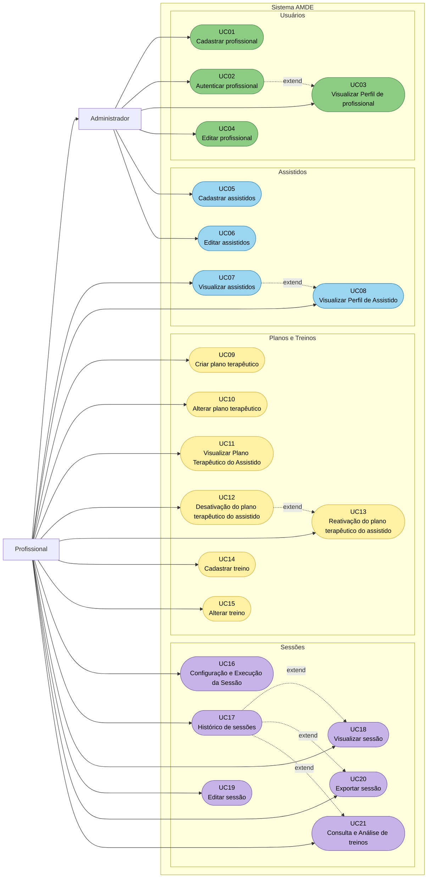

# Diagrama de Casos de Uso — Sistema AMDE

> O diagrama a seguir apresenta as principais funcionalidades do Sistema AMDE e as interações dos atores com a aplicação. São representados os dois perfis de acesso: Administrador e Profissional, considerando suas respectivas responsabilidades e permissões.

---

### Figura – Diagrama de Casos de Uso Geral do Sistema AMDE

<b>Fonte:</b> Elaborado pelos autores.

### Descrição Sucinta das Funcionalidades do Diagrama

- **Cadastrar Profissional:** Permite ao administrador cadastrar profissionais para utilização do sistema.
- **Autenticar Profissional:** Permite que profissionais cadastrados realizem a autenticação e acessem as funcionalidades disponíveis conforme suas permissões.
- **Visualizar Perfil de Profissional:** Permite ao profissional consultar suas informações cadastrais.
- **Editar Profissional:** Permite ao profissional visualizar e alterar seus próprios dados cadastrais.
- **Cadastrar Assistido:** Permite ao administrador registrar novos assistidos, incluindo informações pessoais, dados de atendimento e informações do responsável.
- **Editar Assistido:** Permite ao administrador atualizar as informações cadastrais dos assistidos.
- **Visualizar Assistidos:** Permite ao profissional consultar a lista de assistidos disponíveis para acompanhamento.
- **Visualizar Perfil de Assistido:** Permite ao profissional consultar informações gerais, scores, planos terapêuticos e histórico de sessões de determinado assistido.
- **Criar Plano Terapêutico:** Permite ao profissional criar um plano de intervenção associado a um assistido, definindo seu nome e objetivo.
- **Alterar Plano Terapêutico:** Permite ao profissional responsável atualizar as informações de um plano terapêutico.
- **Visualizar Plano Terapêutico:** Permite consultar as informações de um plano e os treinos associados.
- **Desativar Plano Terapêutico:** Permite ao profissional responsável desativar um plano que não esteja mais em utilização.
- **Reativar Plano Terapêutico:** Permite ao profissional responsável reativar um plano anteriormente desativado.
- **Cadastrar Treino:** Permite cadastrar treinos associados a um plano terapêutico, definindo suas características e o tipo de medição.
- **Alterar Treino:** Permite atualizar as informações de um treino cadastrado.
- **Configurar e Executar Sessão:** Permite ao profissional iniciar uma sessão, selecionar o plano e os treinos que serão realizados e registrar os resultados das atividades.
- **Visualizar Histórico de Sessões:** Permite consultar as sessões realizadas com determinado assistido.
- **Visualizar Sessão:** Permite consultar os detalhes de uma sessão, incluindo treinos executados, resultados e scores.
- **Editar Sessão:** Permite ao profissional corrigir informações de sessões próprias dentro do período de edição estabelecido.
- **Exportar Sessão:** Permite gerar arquivos PDF contendo os registros de uma sessão.

> **Observação:** O Profissional também possui as funcionalidades administrativas atribuídas ao Administrador, conforme a definição dos atores do sistema.