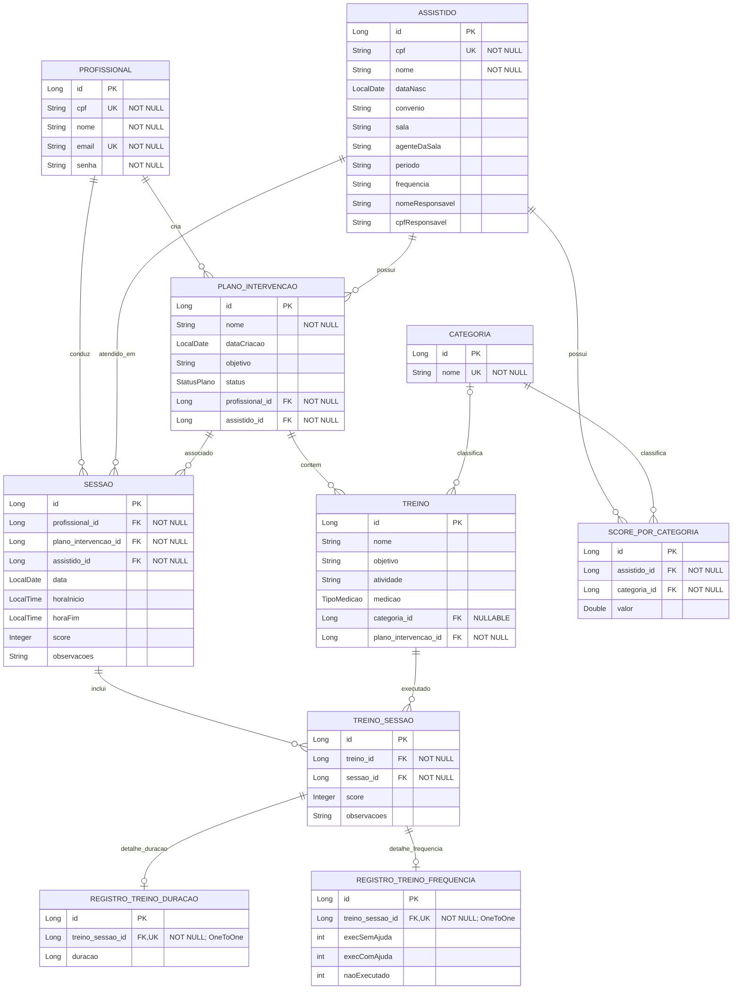

# Modelo Entidade-Relacionamento — ClinicABA (sugestão)

> **Modelo de trabalho para revisão, não aprovado nem aplicado ao banco.** Derivado das entidades JPA existentes em `backend/src/main/java/com/clinicaba/entity/`. Representa o mapeamento observado no código, não comprova o esquema físico em produção. Confirmar o modelo e as decisões marcadas com a equipe/AMDE antes de adotar.

- **Projeto:** Sistema AMDE — ClinicABA
- **Versão:** sugestão 1.0
- **Data:** 03/11/2026
- **Base de código analisada:** branch `main` no commit `a6a262963fde1c9a536ff79cf572b8e15e2b981c`; sugestão consolidada com os demais materiais acadêmicos no commit atual de `main`. Entidades conferidas: `Assistido`, `Categoria`, `PlanoIntervencao`, `Profissional`, `RegistroTreinoDuracao`, `RegistroTreinoFrequencia`, `ScorePorCategoria`, `Sessao`, `Treino` e `TreinoSessao`.
- **Notação:** Crow's Foot; `||` = exatamente um; `o{` = zero ou muitos; `o|` = zero ou um.
- **Restrições:** `PK` = chave primária; `FK` = chave estrangeira; `UK` = único. Comentários `NOT NULL` e `NULLABLE` identificam nulabilidade. O `OneToOne` implica unicidade por registro no mapeamento; o schema físico ainda precisa ser inspecionado.

## DER proposto a partir do mapeamento JPA

Os tipos são os declarados nas classes Java; os tipos SQL efetivos dependem do dialeto/configuração e devem ser verificados no schema criado. `NOT NULL` decorre de `nullable = false`; `NULLABLE` marca a associação sem essa restrição. `UK` identifica CPF/e-mail/nome com unicidade declarada e o lado FK da associação `OneToOne`.

## Dicionário resumido e rastreio

| Entidade | Responsabilidade evidenciada | Identificadores e vínculos observados | Requisitos relacionados |
|---|---|---|---|
| `Profissional` | Conta usada para autenticação e autoria de operações | `id` PK; `cpf` e `email` únicos; possui a propriedade `senha`; cria planos e conduz sessões | RF01–RF04, RF09–RF10, RF12–RF13, RF16, RF20–RF24 |
| `Assistido` | Cadastro da pessoa atendida | `id` PK; `cpf` único; dados cadastrais; `sala` é texto, não FK para entidade Sala | RF05–RF08, RF16, RF21–RF22 |
| `PlanoIntervencao` | Plano vinculado a um assistido e profissional criador | FK obrigatória para `Profissional` e `Assistido`; estado `StatusPlano` | RF09–RF13 |
| `Treino` | Atividade vinculada a plano, categoria opcional e tipo de medição | FK obrigatória para plano; FK opcional para categoria; enum `TipoMedicao` | RF14–RF15, RF17–RF19 |
| `Sessao` | Registro de atendimento ligado a profissional, assistido e plano | Três FKs; data e horários separados; score e observações | RF16–RF24 |
| `TreinoSessao` | Ocorrência de um treino em uma sessão | FKs obrigatórias para `Treino` e `Sessao`; score e observações | RF18–RF20, RF22–RF23; RF25/UC21 opcional, cruzando treino e data da sessão |
| `RegistroTreinoFrequencia` | Contagens de execuções por tipo de ajuda | FK `treino_sessao_id`; três contadores inteiros | RF19 |
| `RegistroTreinoDuracao` | Duração registrada para treino da sessão | FK `treino_sessao_id`; `duracao` Long, unidade não definida no código | RF19 |
| `Categoria` | Classificação de treino e score por categoria | `id` PK; nome único e obrigatório | RF14 |
| `ScorePorCategoria` | Valor associado a assistido e categoria | Duas FKs obrigatórias e `valor`; não há FK para treino nem período/data nesta entidade | RF08; não sustenta sozinho série temporal de RF25/UC21 |

## Restrições a confirmar antes de chamar o modelo de aprovado

1. **Sessão e plano/assistido:** `Sessao` guarda FK para `Assistido` e para `PlanoIntervencao`, mas o mapeamento não garante por si só que o plano pertence ao mesmo assistido da sessão. Definir e validar essa integridade no serviço e/ou banco.
2. **Tipo de registro:** cada entidade de duração/frequência tem FK `OneToOne`, obrigatória e única, para `TreinoSessao`. Isso limita a uma ocorrência de cada entidade por treino-sessão, mas não impede que ambas existam simultaneamente nem exige que exista exatamente uma. Validar a regra exclusiva compatível com `Treino.medicao`.
3. **Score e RF25/UC21:** escala, domínio, nulabilidade, arredondamento e cálculo dos scores precisam de decisão. A análise opcional de histórico de um treino pode ser rastreada por `TreinoSessao` → `Treino` e `Sessao` (que contém `data`). `ScorePorCategoria` não tem FK para treino nem data/período e, isoladamente, não sustenta essa série temporal.
4. **Prazo de edição:** a regra de 24 horas precisa comparar instantes, com fuso acordado. `Sessao` atualmente usa `LocalDate` e `LocalTime` separados e não possui zona/fuso nem instante de encerramento único.
5. **Dados pessoais:** CPF e dados do responsável aparecem no modelo. Confirmar necessidade, acesso, retenção e proteção desses campos; exemplos e ambientes de teste devem usar dados sintéticos.
6. **Credencial:** o campo persistido chama-se `senha`; o diagrama não afirma que a aplicação armazene senha em texto claro. Confirmar e documentar explicitamente o mecanismo de hash antes de aprovar o modelo de segurança.
7. **Campos obrigatórios e unicidade:** `nullable`, tamanho, formato e constraints são indicados apenas onde as anotações JPA atuais os declaram. Confirmar campos obrigatórios do domínio e refletir a mesma regra em validação, banco e testes.

## Diferenças corrigidas em relação ao artefato de classes atual

- O código persiste `Assistido.id` como chave primária e mantém `cpf` como `String` única; o desenho anterior usava CPF como identificador da classe.
- Não há entidade JPA `Sala`: `Assistido.sala` é atualmente uma propriedade textual. Não representar `Sala` como tabela até decisão e implementação explícitas.
- O modelo persistido inclui `ScorePorCategoria`, ausente no desenho anterior.
- `RegistroTreinoDuracao` e `RegistroTreinoFrequencia` são entidades relacionadas a `TreinoSessao`; não são subclasses no mapeamento atual.
- As cardinalidades foram derivadas dos lados proprietários `@ManyToOne`/`@OneToOne`; nulabilidade/unicidade devem ser comparadas ao schema efetivamente gerado antes de qualquer migração.

## Critério de conclusão do C7

Para avaliação consistente para a fase: a equipe deve revisar o diagrama com a implementação, confirmar as sete decisões acima que afetem o escopo atual, gerar/inspecionar o schema em ambiente descartável e manter versão editável do modelo. A aprovação final depende da validação da equipe/AMDE e da correspondência com o banco efetivamente utilizado.

