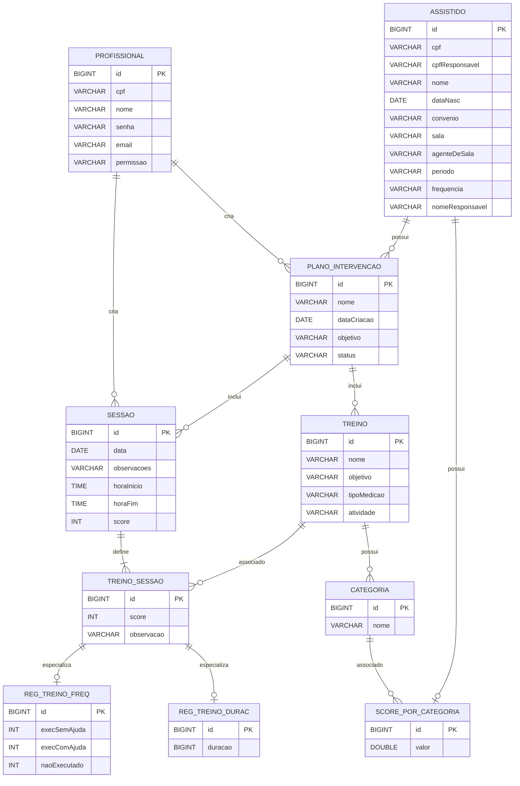

# Modelo Entidade-Relacionamento — ClinicABA

***Aguardando orientações enquanto a dúvida de colocar ou não as Foreign Keys no DER...se for preciso colocar, o modelo de DER sugerido pelo professor é válido e pode ser colocado na doc**

